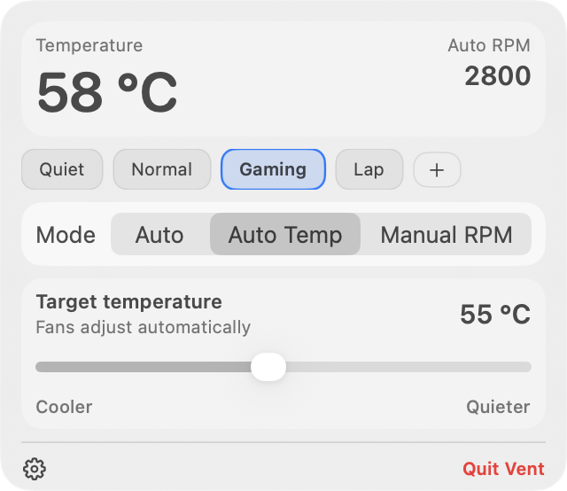
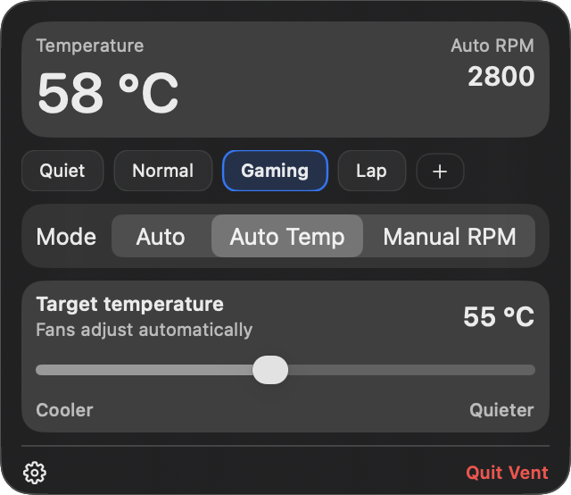
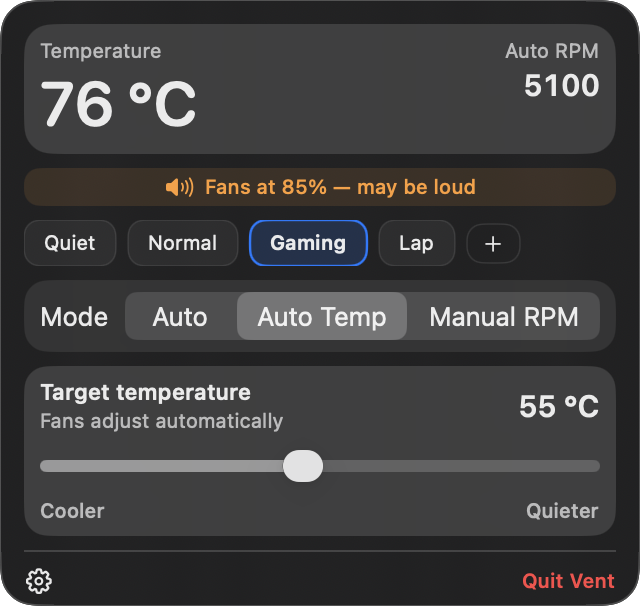

<h1 align="center">🌀 Vent</h1>
<h3 align="center">Wähle eine Temperatur.<br>Vent übernimmt die Lüfter.</h3>
<p align="center">Kostenlose, quelloffene Lüftersteuerung für den Mac. Direkt in deiner Menüleiste.</p>

<p align="center">
  <a href="https://github.com/Fallet666/vent/releases/latest"></a>
  <a href="LICENSE"></a>
</p>
<p align="center">
  <a href="https://github.com/Fallet666/vent/releases/latest"></a>
  
  <a href="LICENSE"></a>
</p>
<p align="center">
  <a href="#install">Loslegen</a> &nbsp; · &nbsp;
  <a href="docs/images/README.md">Screenshots</a>
</p>
<p align="center">
  <a href="README.md">English</a> &nbsp; · &nbsp;
  <a href="README.ru.md">Русский</a> &nbsp; · &nbsp;
  <a href="README.de.md"><strong>Deutsch</strong></a> &nbsp; · &nbsp;
  <a href="README.es.md">Español</a> &nbsp; · &nbsp;
  <a href="README.fr.md">Français</a> &nbsp; · &nbsp;
  <a href="README.pt-BR.md">Português (Brasil)</a> &nbsp; · &nbsp;
  <a href="README.zh-CN.md">简体中文</a> &nbsp; · &nbsp;
  <a href="README.ja.md">日本語</a> &nbsp; · &nbsp;
  <a href="README.ko.md">한국어</a>
</p>

<p align="center">
  
  &nbsp;&nbsp;
  
</p>

<table>
  <tr>
    <td align="center" width="33%"><strong>🌡️ Deine Temperatur</strong><br><br>Wähle ein Ziel. Vent passt die Lüfter an.</td>
    <td align="center" width="33%"><strong>👁️ Sichtbare Warnungen</strong><br><br>Erkenne hohe Lüfterdrehzahlen ohne Ton.</td>
    <td align="center" width="33%"><strong>💚 Jeder Modus ist kostenlos</strong><br><br>Kein Abo. Kein Konto.</td>
  </tr>
</table>

## 🌡️ Deine Temperatur. Deine Wahl.

Du solltest nicht jedes Mal herausfinden müssen, welche RPM bei veränderter Auslastung nötig sind. Wähle in **Auto Temp** eine **Zieltemperatur**, und Vent richtet die Lüfterdrehzahl daran aus. Oder wähle ein integriertes Profil und mach mit dem weiter, was du gerade getan hast.

> [!TIP]
> Die Temperatursteuerung ist enthalten. **Keine kostenpflichtige Stufe, kein Abo, kein Konto.** Vent ist freie Software unter der MIT-Lizenz.

| Was du möchtest | Was du wählst |
|---|---|
| macOS soll die Kühlung verwalten | **Auto** |
| Vent soll die Lüfter auf eine Temperatur ausrichten | **Auto Temp** |
| Genaue RPM selbst festlegen | **Manual RPM**, gemeinsam oder pro Lüfter |
| Schnell zwischen gespeicherten Einstellungen wechseln | **Quiet**, **Normal**, **Gaming**, **Lap** oder ein eigenes Profil |

Eine Zieltemperatur ist ein Ziel, keine Garantie: Das Ergebnis hängt von deinem Mac, der Auslastung und der Umgebung ab. Vent verwendet verfügbare Sensorwerte; die angezeigte Temperatur misst nicht das Gehäuse oder deine Haut.

## 👁️ Erkenne, wenn die Lüfter laut sein könnten

**Du musst die Lüfter nicht hören, um zu wissen, dass sie stark laufen.** Vent zeigt in seinem Panel eine sichtbare Warnung an, wenn die Lüfterdrehzahlen hoch sind. Das ist besonders hilfreich für gehörlose und schwerhörige Menschen sowie für alle, die Kopfhörer tragen.

<p align="center">
  
</p>

Die Warnung schätzt mögliche Geräusche anhand der RPM: Sie erscheint, wenn die höchste aktuelle Lüfterdrehzahl 70 % der höchsten gemeldeten Maximaldrehzahl erreicht. **Sie verwendet kein Mikrofon und misst keine Dezibel.**

Du kannst auch **Notify when fans are loud** in den Settings aktivieren und macOS-Mitteilungen erlauben. Solange Vent läuft, funktionieren die Benachrichtigungen auch bei geschlossenem Panel; die Option muss aktiviert sein und macOS-Mitteilungen müssen erlaubt sein.

## ✨ Kleine App, nützliche Steuerung

- Ein kompaktes Menüleisten-Panel mit hellem und dunklem Systemerscheinungsbild. Kein Dock-Symbol.
- Live-Temperatur und Lüfterdrehzahlen sowie RPM-Steuerung auf Grundlage der gemeldeten Hardwaregrenzen.
- Integrierte Profile sowie eigene speichern, umbenennen und löschen.
- Celsius oder Fahrenheit, beim Anmelden starten und konfigurierbare Update-Prüfungen.
- Das Schließen des Panels behält den gewählten Modus bei.
- `ventctl` für Skripte und Diagnose. Siehe den [Entwicklerleitfaden](docs/DEVELOPMENT.md).

<a id="install"></a>

## 🚀 Loslegen

### Homebrew

```sh
brew tap Fallet666/homebrew-tap
brew install --cask vent
```

### Herunterladen

1. Lade das DMG aus [der neuesten Version](https://github.com/Fallet666/vent/releases/latest) herunter.
2. Ziehe **Vent** nach **Applications** und öffne es.
3. Folge der Einrichtung, um den Helper zu installieren. macOS fragt nach einem Administratorpasswort, weil das Ändern von Lüfterdrehzahlen erhöhte Rechte erfordert.
4. Wähle **Auto Temp** und dann deine Zieltemperatur – oder ein Profil.

Die aktuelle Paketierung nutzt eine Ad-hoc-Signatur statt einer Developer-ID-Notarisierung; daher kann macOS die heruntergeladene App blockieren. Prüfe den Quellcode und die Version, bevor du entscheidest, ob du sie in den macOS-Sicherheitseinstellungen erlauben möchtest.

**Erfordert macOS 13+ und einen Mac mit steuerbaren Lüftern.** Das Projekt unterstützt Intel und Apple Silicon, aber Sensorverfügbarkeit und Lüftersteuerung unterscheiden sich je nach Modell. Ein lüfterloses MacBook Air hat keinen Lüfter zur Steuerung. Bitte [melde die Kompatibilität](https://github.com/Fallet666/vent/issues/new?template=compatibility_report.yml), statt davon auszugehen, dass jedes Modell unterstützt wird.

## ↩️ Zurück zur macOS-Steuerung

> [!IMPORTANT]
> **Das Schließen des Panels behält die gewählten Einstellungen bei; beim Beenden der App kehrt Vent zu Auto zurück.**

Vor dem Beenden wartet Vent auf die Bestätigung des Helpers, dass Auto aktiv ist. Kann Vent Auto nicht bestätigen, bleibt die App geöffnet und zeigt einen Fehler. In den Settings gibt es auch **Uninstall Helper**; dadurch werden die Lüfter auf Auto zurückgesetzt und der Helper entfernt. Lösche die App separat, wenn du sie nicht mehr brauchst.

## 🔒 Datenschutz

Kein Konto und keine Analytik. Die Lüftersteuerung erfolgt lokal über einen Unix-Socket zwischen der App und `ventd`.

**Automatische Update-Prüfungen sind standardmäßig aktiviert** und rufen GitHub für Versionsinformationen auf. Auch das Herunterladen eines Updates verwendet das Netzwerk. Deaktiviere **Automatically check for updates** in den Settings, wenn du keine automatischen Prüfungen möchtest.

## 💚 Hilf Vent, mehr Macs zu erreichen

<p align="center">
  <a href="https://github.com/Fallet666/vent"></a>
  <a href="https://github.com/Fallet666/vent/issues/new?template=compatibility_report.yml"></a>
</p>

Wenn Vent für dich nützlich ist, gib dem Repository einen Stern, teile es mit jemandem, der es braucht, oder sende einen Kompatibilitätsbericht. Auch Fehlerberichte, Übersetzungen und Pull Requests helfen.

Wenn du ein Hardwareproblem meldest, füge dein Mac-Modell, die macOS-Version, das erwartete Ergebnis und die Ausgabe von Folgendem bei:

```sh
ventctl list
ventctl temps
ventctl daemon status
```

## 🛠️ Bauen und beitragen

Build-Anweisungen, CLI-Beispiele und Architektur: [Entwicklerleitfaden](docs/DEVELOPMENT.md).

## Lizenz

[MIT](LICENSE). Nutze sie, prüfe sie und verbessere sie.
