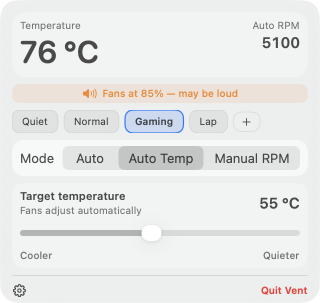
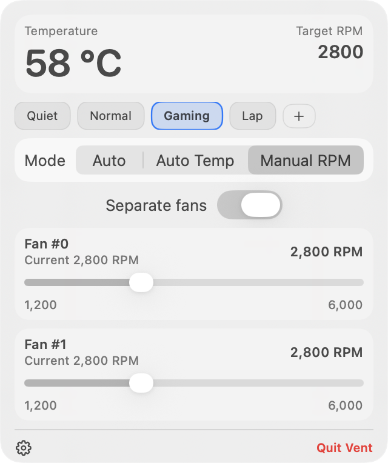
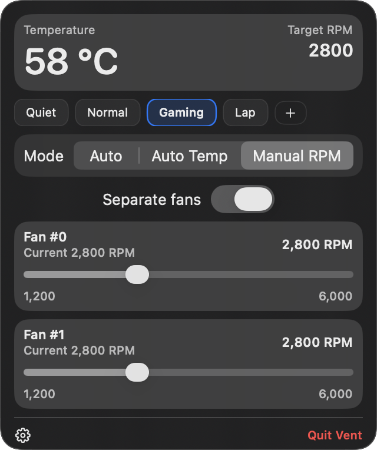
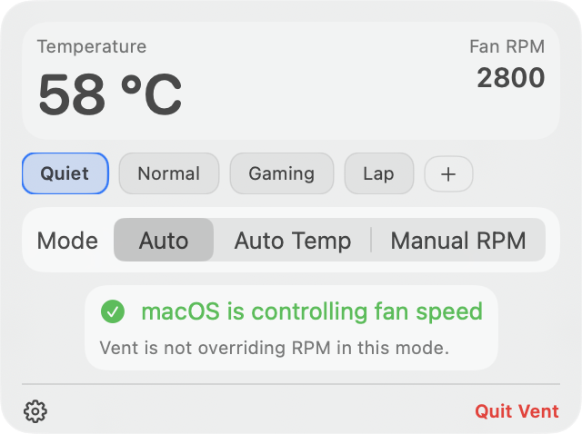
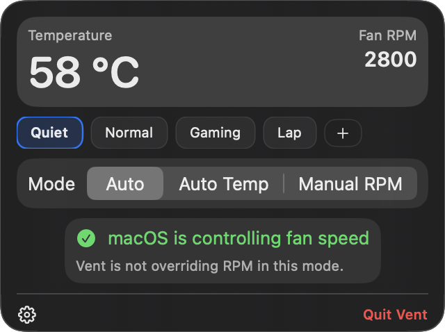

# Vent interface gallery

These are native renders of the actual SwiftUI views, using sample fan readings. They are not measurements of cooling performance. Light and dark follow macOS system appearance. Captured with the macOS 26.5 SDK.

| State | Light appearance | Dark appearance |
|---|---|---|
| Auto Temp |  |  |
| High-speed warning |  |  |
| Manual RPM |  |  |
| Auto |  |  |

Regenerate with [the capture script](../../scripts/capture-screenshots.sh); see [capture details](../DEVELOPMENT.md#documentation-images).
